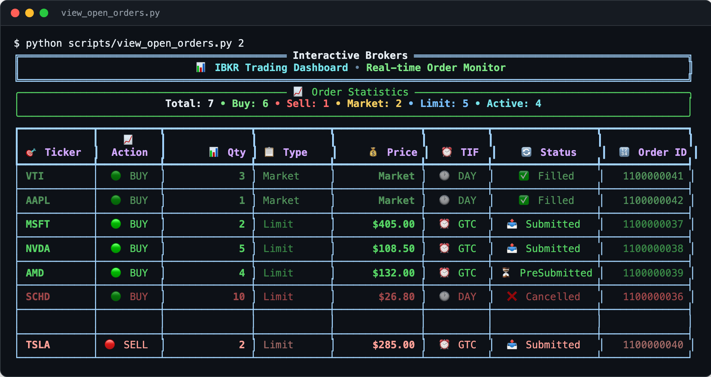

<div align="center">

<h1>ibkr-ibind-rest-api</h1>

<p><b>Recurring stock buys for Interactive Brokers, from a Google Sheet.</b></p>

<p><i>Buying the same few stocks every week shouldn't mean logging in every week. A sheet row and a 9 AM scheduler do it.</i></p>

<h6>


-D81222?style=flat-square)


</h6>

<a href="#how-it-works"><b>How it works</b></a> ·
<a href="#features"><b>Features</b></a> ·
<a href="#run-it"><b>Run it</b></a> ·
<a href="#reference"><b>Reference</b></a>

<br><br>



<sub>Real output of the dashboard's static view, run against a local mock of the <code>/orders</code> endpoint serving demo orders. The sort-options menu above it is cut.</sub>

</div>

<br>

## The problem

Buying a few shares of the same stocks every day, week or month is easy to plan and tedious to
do by hand. This project wraps the IBKR Web API (through [ibind](https://github.com/Voyz/ibind)
and IBKR's OAuth 1.0a) in a small local Flask server, then adds a scheduler that reads a Google
Sheet of recurring orders, places them, logs each fill back to the sheet and posts a summary to
Discord. It runs on your own machine, on `127.0.0.1` only.

## How it works

<table>
<tr>
<td width="33%" valign="top">

**1 · List the orders**

One row per stock in a Google Sheet: `Status`, `Stock Symbol`, `Price`, `Amount`,
`Qty to buy` and `Frequency` (Daily, Weekly or Monthly).

</td>
<td width="33%" valign="top">

**2 · The service checks at 9 AM ET**

An APScheduler service reads the active rows. Daily rows run every day, Weekly on Mondays,
Monthly on the 1st, each as a whole-share market order.

</td>
<td width="33%" valign="top">

**3 · Log and notify**

Each result is written to the next free log cell of that row, like
`✅ 2025-09-18 09:00:15: 1 shares @ $175.50 | ID: 1234567`, and Discord gets an embed with the totals.

</td>
</tr>
</table>

## Features

- **Local REST API over IBKR.** Account, positions (also as CSV), orders, market data, symbol-to-conid lookup, and order placement and cancellation, all as JSON.
- **Order by symbol.** `POST /order/symbol` resolves the ticker to an IBKR contract id and places the order.
- **Percentage orders.** `POST /percentage-order/<symbol>` sizes a limit order from a share of the account or the position.
- **Sheet-driven recurring buys.** Quantity-based market orders on a daily, weekly or monthly schedule, with the run history kept in the sheet.
- **Discord summaries.** A rich embed after each run, plus a "nothing to do today" note listing what comes next.
- **Service manager.** `service.py start | stop | restart | status | logs | execute`, a status endpoint, and a systemd unit installer.
- **Terminal tools.** A Rich orders dashboard with sorting and live refresh, a duplicate-order canceller, a CSV ladder placer and a limit-order rebalancer.
- **ibind examples.** Eleven REST and WebSocket examples from basic queries to bracket orders and options chains in `examples/`.

## Run it

Needs [uv](https://docs.astral.sh/uv/), Python 3.13, an IBKR account with Web API OAuth access, and
optionally a Google service account and a Discord webhook.

```bash
git clone https://github.com/parthchandak02/ibkr-ibind-rest-api.git
cd ibkr-ibind-rest-api
uv sync
cp config.example.json config.json          # add OAuth, Sheets and Discord settings (see below)
uv run python run_server.py &               # REST API on 127.0.0.1:8082
uv run python service.py start              # scheduler + status API on 127.0.0.1:8083
uv run python scripts/view_open_orders.py   # orders dashboard
```

There is no authentication on either server; they are meant for a trusted machine only.

## Reference

<details>
<summary><b>REST endpoints</b></summary>

| Endpoint | Method | Purpose |
|----------|--------|---------|
| `/health` | GET | Server and IBKR connection health |
| `/resolve/<symbol>` | GET | Symbol to IBKR contract id |
| `/account` | GET | Account summary |
| `/positions` | GET | Open positions |
| `/positions/csv` | GET | Positions as a CSV download |
| `/orders` | GET | Live orders |
| `/order` | POST | Place an order by contract id |
| `/order/symbol` | POST | Place an order by ticker |
| `/order/<order_id>` | DELETE | Cancel an order |
| `/percentage-order/<symbol>` | POST | Limit order sized as a percentage |
| `/marketdata` | GET | Market data snapshot |
| `/market-data/current-price/<symbol>` | GET | Current price |
| `/recurring/status` | GET | Recurring system status |
| `/recurring/orders` | GET | Active recurring orders from the sheet |
| `/recurring/execute` | POST | Run the recurring orders now |
| `/recurring/scheduler/start`, `/stop` | POST | Control the scheduler |
| `/recurring/test-notification` | POST | Send a test Discord message |

</details>

<details>
<summary><b>IBKR OAuth setup</b></summary>

Generate keys and configure IBKR OAuth 1.0a:

```bash
openssl genrsa -out private_signature.pem 2048
openssl genrsa -out private_encryption.pem 2048
openssl dhparam -out dhparam.pem 2048

mkdir -p live_trading_oauth_files
mv private_*.pem live_trading_oauth_files/
```

In the IBKR portal:

1. Visit [IBKR OAuth Setup](https://ndcdyn.interactivebrokers.com/sso/Login?action=OAUTH&RL=1)
2. Upload the public keys (`public_signature.pem`, `public_encryption.pem`, `dhparam.pem`)
3. Copy the Consumer Key, Access Token and Access Token Secret
4. Extract the DH prime with `openssl dhparam -in dhparam.pem -text | grep -A 50 "prime:" | tr -d '\n :' | sed 's/prime//'`

</details>

<details>
<summary><b>Google Sheets and Discord setup</b></summary>

**Google Cloud Console**

- Create a project, enable the Sheets API and Drive API
- Create a service account and download its JSON credentials

**The sheet**

- Columns: `Status | Stock Symbol | Price | Amount | Qty to buy | Frequency | Log`
- Share it with the service account email as Editor

| Status | Stock Symbol | Price | Amount | Qty to buy | Frequency | Log |
|--------|-------------|-------|--------|-----------|-----------|-----|
| Active | AAPL | 175.50 | 175.50 | 1 | Weekly | *(auto-filled)* |
| Active | WDH | 1.90 | 1.90 | 1 | Daily | *(auto-filled)* |

Results are written left to right from column G onward, one cell per run.
See [docs/GSHEETS_SETUP_GUIDE.md](docs/GSHEETS_SETUP_GUIDE.md) for the full walkthrough.

**Discord**

Server, then Channel Settings, Webhooks, New Webhook; copy the URL into `config.json`.

</details>

<details>
<summary><b>Configuration (<code>config.json</code>)</b></summary>

Start from [`config.example.json`](config.example.json). The main sections:

```json
{
  "live_trading":  { "oauth": { "consumer_key": "...", "access_token": "...", "access_token_secret": "...", "dh_prime": "...", "realm": "limited_poa" } },
  "paper_trading": { "oauth": { "...": "..." } },
  "google_sheets": { "credentials": { "type": "service_account", "...": "..." }, "spreadsheet_url": "..." },
  "discord":       { "webhook_url": "https://discord.com/api/webhooks/..." },
  "settings":      { "trading_environment": "live_trading", "api_port": 8082, "service_port": 8083, "log_level": "INFO" },
  "scheduling":    { "timezone": "US/Eastern", "daily_check_time": { "hour": 9, "minute": 0 } }
}
```

`config.json` and the OAuth key files are gitignored; keep them local.

</details>

<details>
<summary><b>Service management and troubleshooting</b></summary>

```bash
uv run python service.py status            # background service status
uv run python service.py logs              # recent service logs
uv run python service.py execute           # run the recurring orders once
uv run python service.py stop
curl http://127.0.0.1:8082/health          # API health
curl http://127.0.0.1:8083/service/status  # service status
curl -X POST http://127.0.0.1:8082/recurring/execute
```

| Issue | Solution |
|-------|----------|
| "IBKR client not available" | Check the OAuth files in `live_trading_oauth_files/` |
| "Google Sheets auth failed" | Check the service account has Editor access to the sheet |
| "Service not running" | Run `uv run python service.py status` |
| "Config errors" | Validate the JSON: `python -m json.tool config.json` |

</details>

<details>
<summary><b>Development and project layout</b></summary>

```bash
uv sync --dev
uv run pytest
uv run ruff format .
uv run ruff check .
```

```
backend/      Flask API (api.py, api_recurring.py), ibind client setup, trading and account operations,
              recurring orders engine, Sheets integration, sequential logger, Discord notifier
service/      APScheduler service and the start/stop/status manager behind service.py
scripts/      Orders dashboard, duplicate canceller, CSV ladder placer, limit-order rebalancer
examples/     ibind REST and WebSocket examples
docs/         System overview, Sheets setup guide, set-and-forget guide, repository structure
tests/        Recurring system and Sheets integration tests
```

</details>

<br>

<div align="center">
<sub>Built with ibind, Flask, APScheduler, gspread and Rich. Not affiliated with Interactive Brokers.</sub>
</div>
